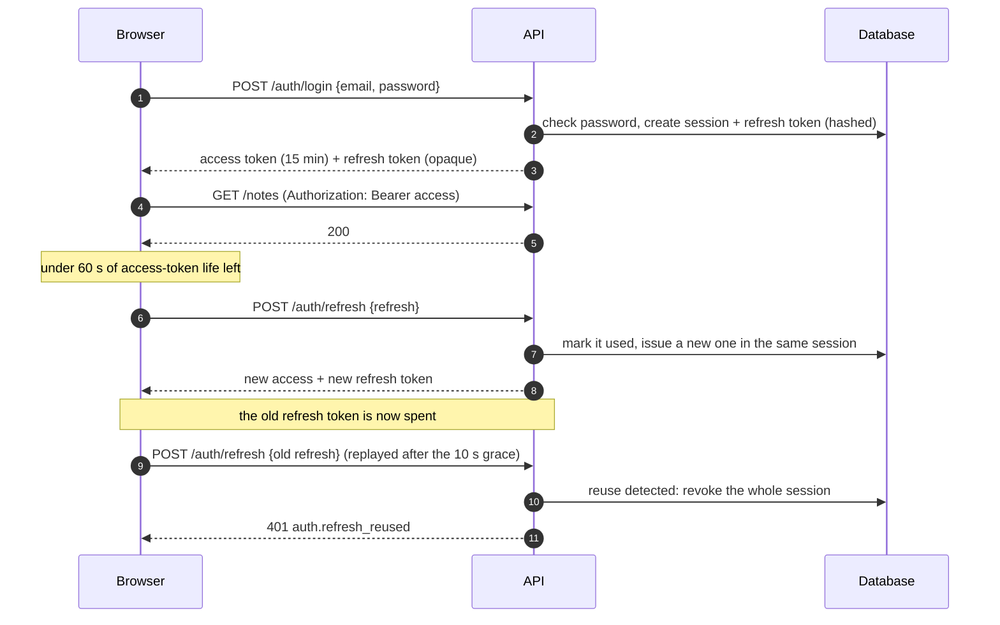

# Architecture

How the pieces fit together, why they are built this way, and checklists for the changes
you'll make most often.

## Overview

```
Browser ── /api/* ──┐                         ┌──────────── backend (Spring Boot, :8080) ────────────┐
        ── pages ───┤  Traefik (prod, :443)   │ RequestIdFilter → Spring Security (JWT) → rate limit │
                    │  Vite proxy (dev, :5173)│ → controller → service (@Transactional) → repository │
                    ▼                         └───────────┬──────────────┬───────────────┬────────────┘
           frontend (SvelteKit, :3000)                    │              │               │
           SSR for public pages; it calls the API         PostgreSQL     SMTP           S3 storage
           directly at API_INTERNAL_URL                   (Flyway)       (after commit)  (optional)
```

- **One origin.** The browser loads pages and calls `/api/...` on the same domain. Traefik in production and Vite in development route each path to its service. There's no CORS to configure, and the API URL never ends up in a build.
- **The API is the only source of truth.** The frontend has no database or business logic, and no server endpoints besides `/healthz`. Web, single-page and mobile builds all talk to the same API.
- **Public pages render on the server; the app renders in the browser.** The landing page and the sign-in pages are server-rendered for fast first paint and link previews. Pages behind sign-in (`(app)`) render in the browser, where the tokens are.

## Backend

### Modules

The code is grouped by feature, not by layer (as in Wingeo). A feature owns its slice end to end. Larger
features use `controller/ dto/ model/ repository/ service/` subpackages. Small ones (`audit`,
`settings`, `mail`, `storage`) keep a few files side by side.

| Package | Responsibility |
|---|---|
| `auth` | Sign-up, sign-in, Google, refresh, sign-out, email confirmation, password reset, invitations. Owns sessions, refresh tokens and single-use email tokens. Also the first-admin bootstrap and the nightly cleanup. |
| `user` | The `User` entity, `/api/v1/me` (profile, password, sessions, avatar, account deletion). |
| `admin` | User management and stats for administrators. |
| `audit` | Append-only `audit_events`. Written in the same transaction as the change it records. |
| `settings` | Runtime settings, editable by admins without a redeploy. |
| `mail` | Renders localized emails (Thymeleaf, HTML and text) and sends them after commit, with retries. |
| `storage` | S3 storage, avatar processing and the file proxy. Only active with `STORAGE_ENABLED=true`. |
| `catalog` | The store's categories and products: the public catalog (`/api/v1/public/shop`), the search engine and its insights, the sitemap data, admin CRUD, product photos, the demo seeder. See [SHOP.md](SHOP.md). |
| `order` | Cart pricing, checkout with atomic stock updates, order history, admin order handling and order emails. See [SHOP.md](SHOP.md). |
| `note` | The example module: copy it, then delete it. |
| `shared` | Cross-cutting pieces: typed configuration (`AppProperties`), security, errors, paging, request IDs, locales. |

Conventions:

- **Controllers stay thin.** They validate (`@Valid`), resolve the `CurrentUser` and `ClientContext` arguments, and call one service method.
- **Services own transactions.** Write methods are `@Transactional`; reads use `readOnly = true`.
- **DTOs are Kotlin data classes.** Entities never leave the service layer.
- **Ids are UUIDv7,** generated in Kotlin: time-ordered, so they work well as primary keys.
- **The schema belongs to Flyway.** Hibernate only validates (`ddl-auto: validate`), and `open-in-view` is off.

### Errors

Every error is an RFC 9457 `application/problem+json` document with a stable `code`:

```json
{
  "type": "about:blank",
  "title": "Unprocessable Entity",
  "status": 422,
  "detail": "Some fields are invalid",
  "code": "request.validation",
  "fields": { "email": { "code": "Email", "message": "must be a well-formed email address" } }
}
```

Services throw the exceptions in `shared/error/AppException.kt` (`NotFoundException`,
`ConflictException`, `FieldValidationException`, …), each with a `code`. `GlobalExceptionHandler`
turns them into problem documents, along with validation errors, malformed JSON, optimistic
locking conflicts (`conflict.stale`) and unexpected errors. Unexpected errors are logged, and
the response never includes a stack trace.

The frontend translates `code`, never `detail`: `errorMessage()` in `src/lib/api/errors.ts` maps codes to messages, and `fields` land on the matching form inputs.

### Authentication

Access tokens are short-lived JWTs (HS256, 15 minutes). Refresh tokens are random strings
stored as SHA-256 hashes, one row per use, grouped into a **session** per device.

Access token claims:

| Claim | Meaning |
|---|---|
| `sub` | user id |
| `role` | `USER` or `ADMIN` |
| `sid` | session id |
| `sv` | the user's security version |

Spring Security's resource server checks each token's signature and expiry. `UserSecurityStateValidator` also rejects the token when:

- the account is disabled, or
- `sv` no longer matches the user's security version.

The security version goes up on:

- a password change or reset;
- a role change;
- disabling the account;
- an admin's "sign out everywhere".

So those changes take effect at once on this instance, and within 30 seconds on others (the user state cache).



The browser refreshes a token while it's still valid, so requests don't fail on an expired token.

Two tabs could otherwise refresh at the same moment and spend the same token. To prevent that:

- **within one tab**, concurrent calls share one refresh (`refresh()` is single-flight);
- **across tabs**, a Web Lock serializes refreshes, and each tab re-reads storage after taking the lock, so a tab adopts tokens another tab just rotated instead of spending the same refresh token twice;
- **as a last resort**, a token reused within 10 seconds is still accepted.

Signing out revokes the session on the server, then forgets the tokens.

**Email links** (confirmation, password reset, invitation) carry random single-use tokens:

- stored hashed, and expiring (48 h, 1 h and 7 days);
- a link opens a frontend page, which spends the token with a `POST`. Email scanners that follow links can't burn them, and neither can link previews;
- a password reset or an accepted invitation also confirms the email address, revokes every other session and signs the user in.

**"Forgot password" and "send the link again" answer the same way whether or not the account exists,** so they can't be used to discover who has an account.

**Google sign-in** uses Google Identity Services:

1. The browser receives an ID token and posts it to `/api/v1/auth/google`.
2. The backend verifies it against Google's keys (issuer, audience, expiry, verified email).
3. It finds or creates the user, then issues the app's own tokens.

When linking Google to an existing account whose email was never confirmed, that account's
password is removed and its sessions are revoked. Otherwise someone who registered your
address before you could keep a way in.

### Email

Services call `AccountMailer`, which publishes an `OutgoingMail` event. `MailDispatcher` sends it:

- after the transaction commits (`@TransactionalEventListener`), so a rolled-back sign-up never sends an email;
- on a small background pool, so a slow SMTP server never holds a request;
- up to three times, with backoff.

`MailRenderer` builds the HTML (`templates/mail/action.html`) and plain-text versions in the user's language, with the layout mirrored for Arabic.
Without `MAIL_HOST`, emails are written to the log instead.

## Frontend

### Routes

```
src/routes/
├── +layout.ts           loads the public config (app name, flags, settings) from the API
├── (marketing)/         store home, products and search, categories,  SSR
│                        product page
│   ├── cart/            the cart (kept in localStorage)               browser only
│   └── checkout/        address and payment, needs an account         browser only
├── (auth)/              login, register, forgot/reset password, verify SSR, guest-only where it matters
├── (app)/               dashboard, my orders, notes, settings         browser only, signed in
│   └── admin/           overview, orders, products, categories,       browser only, ADMIN
│                        appearance, users, settings, audit
├── sitemap.xml/         generated from the catalog
├── robots.txt/          points to the sitemap
└── healthz/             container health check
```

Route groups (the parenthesized folders) don't appear in URLs. Each group has its own layout:

- `(auth)` shows a centered card;
- `(app)` shows the sidebar shell;
- `(app)/+layout.ts` is the sign-in guard;
- `admin/+layout.ts` is the role guard. The API enforces roles too; the guard just avoids showing pages that would fail.

### Session and API calls

- `lib/auth/session.svelte.ts` holds the tokens and the user as `$state`:
  - it refreshes proactively;
  - refreshes are single-flight across tabs (Web Locks);
  - it syncs sign-in and sign-out between tabs through `storage` events.
- `lib/auth/storage.ts` decides where tokens live: `localStorage` by default. Swap it for Capacitor Preferences in a mobile build ([MOBILE.md](MOBILE.md)).
- `lib/api/client.ts` is an `openapi-fetch` client typed from the backend's OpenAPI spec:
  - `lib/api/schema.d.ts` is generated by `npm run gen:api`. Rerun it after changing an endpoint.
  - `call(...)` returns the data or throws an `ApiError`.
  - `callForPage(...)` does the same in `load` functions, turning API errors into SvelteKit's error page (404 → "not found", …).
- Server-side rendering calls the API through `handleFetch` (`hooks.server.ts`):
  - relative `/api/...` requests go straight to `API_INTERNAL_URL`, with a 3-second timeout;
  - this avoids routing back through the public domain, which often hangs inside Docker.
- Server-rendered store pages use `storeApi(fetch, url)` from `lib/shop/store-api.ts` instead of `api`: the same typed client, but going through SvelteKit's `fetch` so it works during SSR. `loadOrError(...)` is its `callForPage`.

### Forms

`lib/forms/form.svelte.ts` is a small runes form helper:

- `values` is deep `$state`, so inputs bind directly;
- zod validates on submit, with messages from `lib/forms/schemas.ts`, translated at validation time;
- field errors from the API (422) appear under the matching inputs, and other errors at the top of the form.

```svelte
<script lang="ts">
	const form = createForm({
		schema: z.object({ title: required(200) }),
		initial: { title: '' },
		onSubmit: async (values) => {
			await call(api.POST('/api/v1/notes', { body: { ...values, content: '', pinned: false } }));
		},
	});
</script>

<form onsubmit={form.submit} novalidate>
	<FormAlert message={form.formError} />
	<Field.Field data-invalid={!!form.errors.title}>
		<Field.Label for="title">{m.notes_field_title()}</Field.Label>
		<Input id="title" bind:value={form.values.title} />
		<Field.Error errors={form.fieldErrors('title')} />
	</Field.Field>
	<SubmitButton busy={form.submitting}>{m.common_save()}</SubmitButton>
</form>
```

For an edit form, pass `initial: () => ({ ... })` built from props, and render the component inside `{#key item.id}`, so opening another item starts a fresh form (see `NoteEditor.svelte`).

### UI components

- `lib/components/ui/` holds shadcn-svelte components. They belong to you, but add new ones with the shadcn-svelte CLI (`npx shadcn-svelte@latest add <name>`) rather than writing them by hand.
- `lib/components/app/` holds app-wide pieces: sidebar, user menu, theme and language switchers, confirm dialog, password input, page header, SEO tags.
- Icons come from `@lucide/svelte/icons/<name>`, one import per icon, which keeps bundles small.

### Languages and right-to-left

Translations live in `frontend/messages/{fr,en,ar}.json`. Paraglide compiles them into typed
functions: `m.notes_title()`, `m.notes_count({ count })`. Every visible string goes through them.

- **Plurals** follow each language's rules; Arabic has six forms. See `notes_count` in the message files.
- **Choosing the language:** a cookie, then the browser's `Accept-Language`, then French. The server sets `<html lang dir>`, so Arabic pages are right-to-left before any script runs.
- **Account language:** switching language updates the user's account, so emails follow it too.
- **Layout mirroring:** use logical utilities (`ms-*`, `me-*`, `ps-*`, `pe-*`, `start-*`, `end-*`, `text-start`) instead of `left`/`right` ones; `npm run lint` rejects physical ones. Flip directional icons with `rtl:rotate-180`.
- **Dates and numbers:** format them with `lib/i18n/format.ts`, never by hand.

The backend has its own messages (`resources/i18n/messages*.properties`) for emails.

## Checklists

### Add a feature

Follow the `notes` module, which is built to be copied.

Backend:

1. **Migration:** the next `backend/src/main/resources/db/migration/V<n>__<feature>.sql`. Never edit a migration that has already run anywhere; add a new one.
2. **Entity and repository** in `<feature>/model` and `<feature>/repository`.
3. **DTOs** in `<feature>/dto`, with Bean Validation annotations on requests.
4. **Service** in `<feature>/service`: transactions, authorization (load by owner), and audit records if it matters.
5. **Controller** in `<feature>/controller`: `@Tag` for Swagger, `CurrentUser` as a parameter.
6. **Error codes** (`<feature>.not_found`, …), thrown through the `AppException` classes.
7. **Tests:** an integration test extending `IntegrationTest` covering the happy path, validation and other users' data.

Frontend:

8. **API types:** with the backend running, `npm run gen:api` (in `frontend/`).
9. **Pages:** `src/routes/(app)/<feature>/+page.ts` loads with `callForPage(api.GET(...))`, and `+page.svelte` renders.
10. **Navigation:** an entry in `src/lib/config/nav.ts`.
11. **Messages:** keys in all three files under `messages/`, plus new error codes in `errorMessage()`.
12. **End-to-end test** in `tests/e2e/` for the main flow.

### Add a runtime setting

1. Add an entry to the `Setting` enum (`backend/.../settings/Settings.kt`) with its key, type, default, whether the frontend may read it, and a description. Types: `BOOLEAN`, `INTEGER` (optional `min`), `STRING` and `TEXT` (multi-line; `maxLength`, optional `pattern`), `URL` (http(s) only), `COLOR` (`#rrggbb`) and `CHOICE` (one of `options`). Each gets a matching input in the admin.
2. In the backend, read it with `settings.bool(Setting.X)`, `settings.string(...)` or `settings.int(...)`.
3. In the frontend (client-visible settings only), read `data.config.settings['your.key']`.

It appears in **Administration → App settings** automatically. No migration is needed, because a missing row means "default".

### Add an email

1. Add a value to `MailKind` (`mail/Mail.kt`) and a method to `AccountMailer`.
2. Add `mail.<key>.subject`, `.preheader`, `.intro`, `.action` and `.outro` to the three `messages*.properties` files. `{0}` is the app name; further arguments follow.
3. Call the mailer from a service inside its transaction: the email goes out after commit.
4. Check the rendering in Mailpit, and extend `MailRenderingIntegrationTest`.

### Add a role

1. Backend:
   - add the value to `Role` (`user/model/Role.kt`);
   - widen the `role` check constraint in a new migration;
   - place the role in the hierarchy (`SecurityConfig.roleHierarchy`);
   - protect endpoints with `@PreAuthorize("hasRole('X')")` or a path rule.
2. Frontend:
   - run `npm run gen:api`;
   - add role labels (`admin_role_*`) and options in the admin user form and filters;
   - guard pages or navigation groups as `admin/+layout.ts` and `nav.ts` do.

### Add a language

1. Frontend:
   - add the locale to `project.inlang/settings.json`;
   - create `messages/<locale>.json` with every key;
   - add a name in `LOCALE_NAMES` (`lib/i18n/locale.ts`) and an `Intl` locale in `lib/i18n/format.ts`.
2. Backend:
   - add it to `SupportedLocales.ALL` and `isRtl` if it's written right to left;
   - create `i18n/messages_<locale>.properties`.

## Compared with Wingeo and TuniMarché

| Topic | Before | Here |
|---|---|---|
| Schema | `ddl-auto: update` (Wingeo); Flyway validation off (TuniMarché) | Flyway migrations, schema validated at startup |
| Refresh tokens | none (Wingeo); "rotation" that stored nothing (TuniMarché) | hashed, stored, rotated, reuse detection, revocable sessions |
| Revocation | tokens valid until expiry | security version checked on every request (cached ≤ 30 s) |
| Email | none | confirmation, reset, invitation, change notices, in 3 languages, after commit |
| Google sign-in | required config (Wingeo) | optional; closes the pre-registered-account takeover |
| Admin checks | manual checks in controllers | method security + role hierarchy, last-admin guards |
| Errors | ad-hoc JSON | RFC 9457 with stable codes and field errors |
| Object storage | MinIO, required | S3-generic, optional; RustFS in Docker (MinIO community images are discontinued) |
| API types in the frontend | hand-written | generated from OpenAPI |
| Tests and CI | few or stale, no CI | unit, integration (Testcontainers), Vitest, Playwright, GitHub Actions |
| Containers | root users, one shared `.env` passed to every container | non-root, health checks, each service gets only its own variables |
| Security headers | none | strict CSP, nosniff, frame denial, referrer policy, HSTS |

## Trade-offs worth knowing

- **Bearer tokens in localStorage, not cookies.** The same code works on the web and in a Capacitor app, and there's no CSRF to handle. The cost: a script injected into a page could read the tokens. The strict CSP is the main defense, together with short access tokens and refresh reuse detection. If your threat model needs it, move the refresh token to an `httpOnly` cookie set by the API.
- **Pages behind sign-in aren't server-rendered.** The server doesn't hold the user's tokens, so it can't fetch their data. Public pages are still rendered on the server for SEO and fast first paint.
- **Single instance.** Rate limits and caches live in memory ([DEPLOYMENT.md](DEPLOYMENT.md#10-security-checklist)).
- **SvelteKit 2.** SvelteKit 3 was released in October 2026. The code uses `$app/state` only (ESLint bans `$app/stores`), so moving up should be `npx sv migrate sveltekit-3` plus a review.
